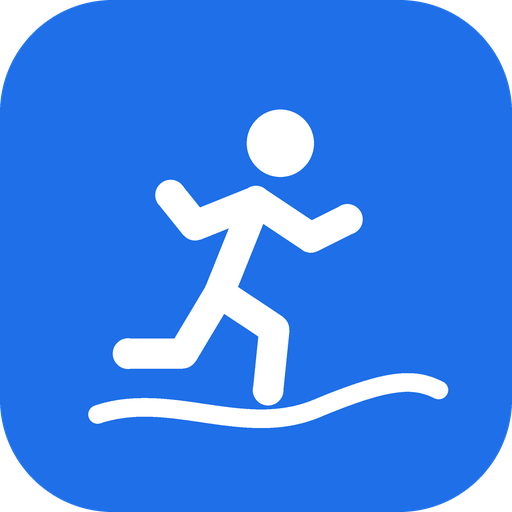
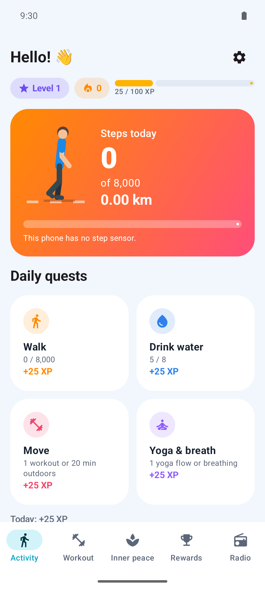
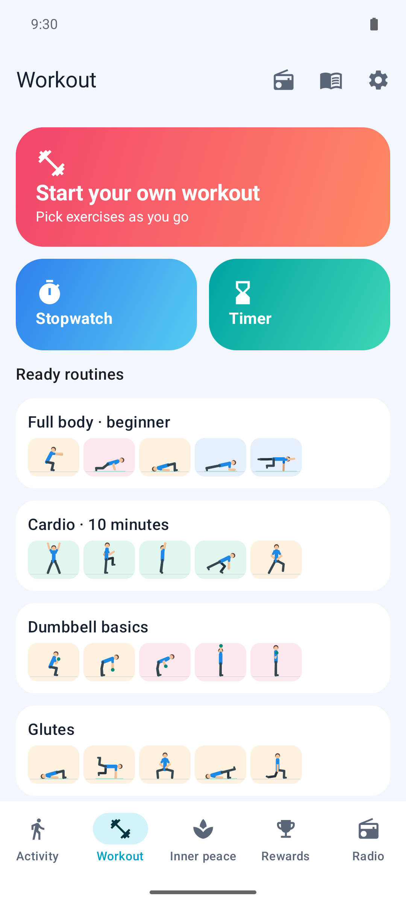
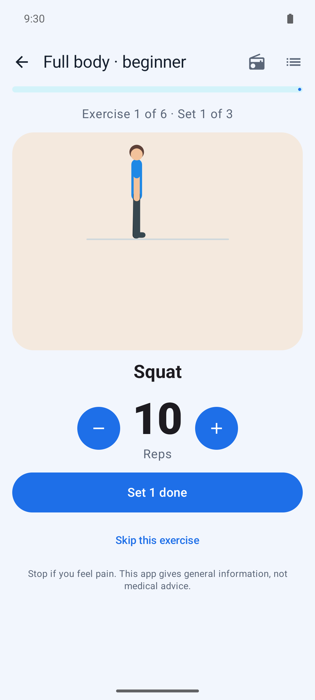
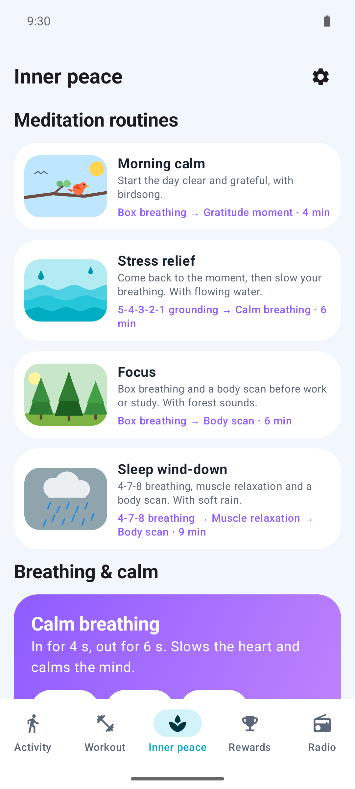
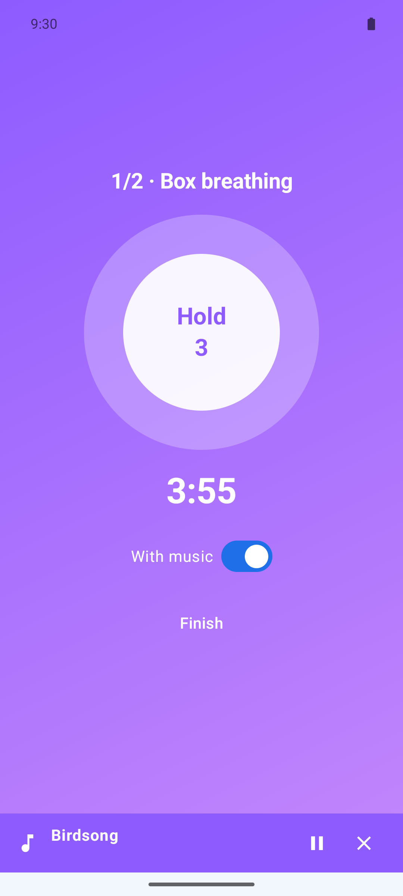
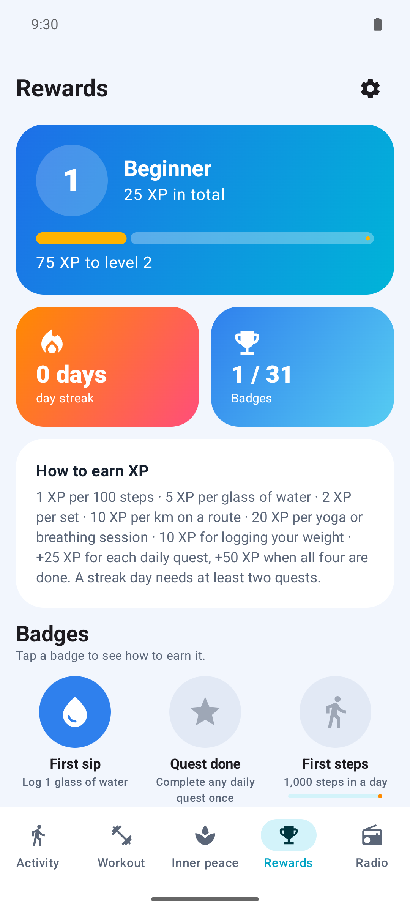
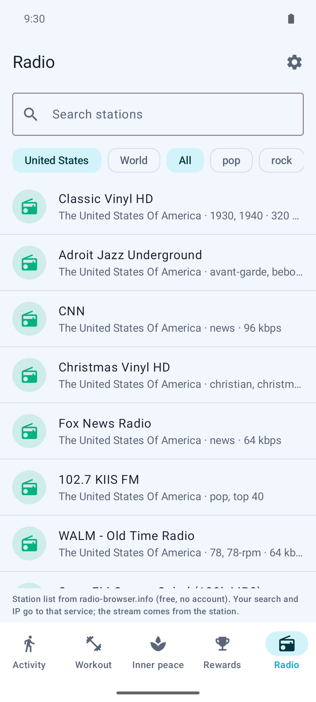
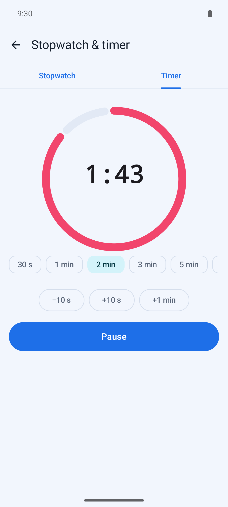

# FitVita

*Sport and healthy living, made fun.* Move, drink, breathe and level up on Android.

A colourful, gamified healthy-living app. No account, no ads, no trackers, no server: everything
stays on your phone.

<p>
  
  
  
  
  
  
  
  
</p>

## Download

- **GitHub:** the latest signed APK is on the [Releases page](https://github.com/smyrna-pergamum/fitvita/releases/latest).
  Each release has a `.sha256` file to check the download. New versions install over old ones and keep your data.
- **F-Droid:** submitted, [waiting for review](https://gitlab.com/fdroid/fdroiddata/-/merge_requests/54988).
  F-Droid builds will carry the same signature as the GitHub releases, so you can switch between them.

Requires Android 8.0 (API 26) or newer. No Google Play Services needed.

## Website

An experimental, playable landing page lives in [`docs/`](docs): a knockout intro, a sticky app tour, the app's
daily quests to tap through, the meditation music, nature sounds and live radio, and the three breathing patterns.
Open `docs/index.html` in a browser, or serve the folder with GitHub Pages (Settings → Pages → `main`, `/docs`).

## Features

- **Activity (home)** – step counter with an animated walking buddy, walked distance and 7-day bars;
  four daily quests (walk, drink water, move, yoga & breath); water tracker; GPS route recording.
- **Workout** – start your own workout or a ready routine (full body, cardio, dumbbell basics, glutes,
  legs, waist & belly), yoga and pilates flows, 53 illustrated exercises, one-tap sets, rest timer,
  stopwatch and countdown timer.
- **Guided workouts** – preview a routine, then do it one exercise at a time with countdowns,
  beeps and rest timers.
- **Inner peace** – meditation routines (morning calm, stress relief, focus, sleep wind-down),
  calm, box and 4-7-8 breathing, body scan, 5-4-3-2-1 grounding, muscle relaxation and gratitude.
- **Meditation music and nature sounds** – 11 calm tracks with a sleep timer, and 10 illustrated,
  endlessly looping sounds (birds, wind, water, forest, restaurant, city centre, rain, fire,
  night crickets, aquarium).
- **Radio** – free internet radio from the Radio Browser directory (local, world, all or by genre;
  HTTPS streams only), also reachable from workout and route screens. A mini player with
  play/pause and next stays at the bottom.
- **Rewards** – XP, levels and ranks, day streaks, 31 badges (tap one to see how to earn it) and
  confetti when a quest is done.
- **Weight & BMI** – daily weigh-ins, BMI with WHO bands, female/male reference weight
  (Devine formula), weight goal and trend chart.
- **History** (in Settings) – workouts and routes; share a route as a picture, save it or export GPX.
- **Reminders** – friendly nudges for water (with a "+1 glass" button in the notification), moving,
  workouts and yoga; they stay quiet once the goal is reached.
- **Backup** – password-protected backup and restore of all your data.
- Four themes (Blue, Dark, Pink, Brown) and seven languages: Türkçe, English, Deutsch, Español,
  Français, Русский, العربية.

## Privacy

Your data never leaves the phone. Sets and routes are encrypted with a key kept in Android
Keystore. Location is used only while you record a route, the step counter is off until you turn it
on, and the only network traffic is the radio you choose to play and the map tiles. Details in
[PRIVACY.md](PRIVACY.md).

## Building

Kotlin, Jetpack Compose, Material 3, Navigation, Room, DataStore, Media3/ExoPlayer, osmdroid.

```
./gradlew testDebugUnitTest
./gradlew assembleDebug
```

See [BUILDING.md](BUILDING.md) for requirements, generated resources and release signing.
Application ID: `io.github.smyrna_pergamum.exercisetracker`.

## Licence

Code: [GPL-3.0-or-later](LICENSE). Illustrations and exercise texts: CC-BY-SA-4.0 (own work).
Changes per version: [CHANGELOG.md](CHANGELOG.md).

## Third-party content

All bundled sounds come from [Wikimedia Commons](https://commons.wikimedia.org/) under free licences.
They were trimmed (long recordings to 5–10 minutes, with fades for looping), loudness-normalised and
re-encoded to Opus (music 48 kbps, nature 32 kbps); the changed versions keep the original licence.

- Meditation music by Kevin MacLeod (incompetech.com): Meditation Impromptu 01/02/03, Healing,
  Relaxing Piano Music, Dreamer, Floating Cities, Jellyfish in Space, Soaring, Ossuary 5 – Rest
  (CC BY 3.0) and Wholesome (CC BY 4.0).
- Nature sounds:
  - Birds: "Birdsong morning 01" by Matutinho (CC BY-SA 4.0)
  - Wind: "Wind sounds 2020-05-10 1625" by Robert EA Harvey (CC BY-SA 4.0)
  - Water: "stream-river-water-up-close" by jackthemurray (CC0)
  - Forest: "Waidachswald Oberschefflenz Abend 20250616" by Evillan (CC0)
  - Restaurant: "Cafe ambiance" by Marble Toast (CC0)
  - City: "Sunday in the city street noise1" by cori (public domain)
  - Rain: "Light Rain Distant Thunder July 5th 2016" by kvgarlic (CC0)
  - Fire: "Campfire sound ambience" by Glaneur de sons (CC BY 3.0)
  - Night: "Crickets choir" by Serg Childed (CC BY-SA 4.0)
  - Aquarium: "Artis, bak van het aquarium" by Beeld en Geluid (CC BY-SA 3.0)

  Scene pictures are own work.
- Radio station list: [radio-browser.info](https://www.radio-browser.info/) (public domain data, free API).
- Map tiles and data: © OpenStreetMap contributors (ODbL).
- Website (`docs/`): videos and photos from [Pexels](https://www.pexels.com/license/) (free to use), trimmed and
  compressed; sound previews are short clips of the bundled audio above. Fonts Unbounded, Manrope and JetBrains Mono
  (SIL Open Font License) load from Google Fonts.
- Libraries: AndroidX, Jetpack Compose, Room, DataStore, Media3/ExoPlayer, osmdroid, kotlinx – Apache-2.0.
